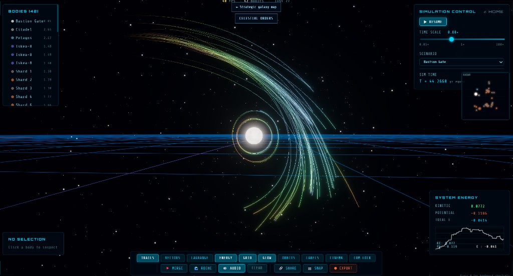
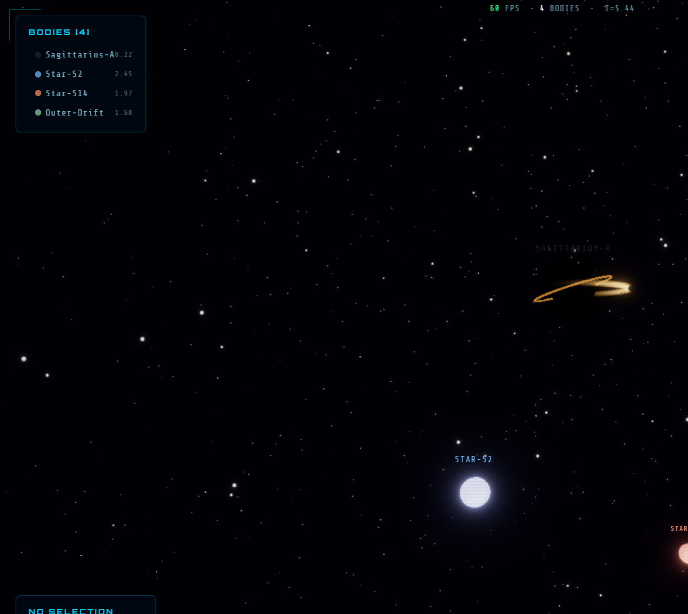
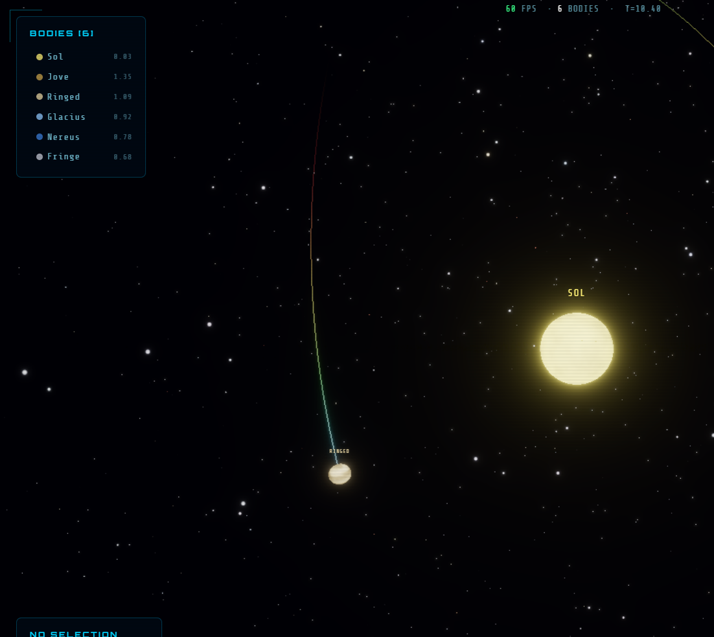
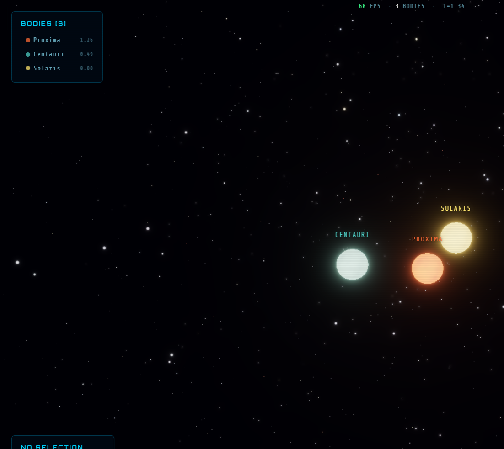

<div align="center">

# ✦ Quantum Rim

### Govern the rim. The stars keep the receipts.

A browser galaxy you can actually command: persistent worlds, a legible economy, forecastable crises, short emergency actions, ruin expeditions, and a cinematic N-body system view when you want to watch the physics happen.

[**Enter the live system view →**](https://gravitas-kappa.vercel.app/simulation) · [Landing](https://gravitas-kappa.vercel.app) · [Services](https://github.com/markaschmidt/Quantum-Rim-Services)


</div>

The public host is the celestial theater: RK4 gravity, inclined orbits, accretion disks, Roche rings, and a starfield you can orbit with the mouse. Galactic command — the strategic layer in this repository — runs beside it, and stays playable when the network is down.

<p align="center">
  
</p>

<p align="center">
  
  
  
</p>

<p align="center"><sub>Celestial Orders in galactic command. The smaller frames are from the system view.</sub></p>

---

## The command loop

1. Select a system and inspect one of its persistent planets.
2. Read settlement output, suitability, warnings, history, and Atlas transformation plans.
3. Meet a crisis whose cause is visible before the timer starts.
4. Finish a 20–90 second response before the deadline.
5. Commit the response immediately. The service resolves the bounded Atlas aftermath in the background and attaches artifacts plus provenance to the planet.
6. Launch a ruins expedition, spend supplies, reveal connected nodes, and write the findings into planetary history.
7. Ask an Imperial advisor. The conversation goes through the server-side OpenRouter gateway, never through a key in the browser.

An event director advances one strategic cycle every five seconds. It keeps a 4–8 cycle cooldown, caps the galaxy at three unresolved crises, and prefers high-pressure systems. It keeps running in both the galaxy map and the 3D system view.

## Two theaters

| Theater | What you do there |
| --- | --- |
| **Galaxy command** | Core Worlds, Inner Rim, and Outer Rim. Settlements, routes, defenses, credits, food, water, energy, alloys, exotic matter. |
| **System view** | The inherited Three.js sandbox. Merge or elastic collisions, tidal heating, Lagrange points, black-hole photon rings, velocity trails, cinema camera. |

Small-body collisions ask Coin Toss for a bounded encounter branch and Labyrinth for the debris topology. Those paths show up as hazard lanes on the galaxy map.

## The quantum boundary

Classical state stays authoritative. Moth Atlas supplies bounded variation, connected topology, visual plans, and atmosphere. Every service call has a deterministic fallback, so the game remains playable without credentials.

| Engine | Role in play |
| --- | --- |
| **Coin Toss** | Crisis branches and uncertain discoveries |
| **Labyrinth** | Routes, affected districts, ruin topology |
| **Tessa Image** | Long-term planetary surfaces and atmosphere |
| **Blur** | Impact, storm, radiation, and lensing aftermath |
| **Telablur** | Paired worlds and linked anomaly states |
| **Retrocausal Echo** | Premonitions, clues, history, and event audio |

Provenance badges distinguish a completed Atlas result, an emulation, planned work, and a classical fallback.

## Architecture

```text
Quantum Rim
  ├── strategic Zustand store (authoritative local game state)
  ├── galaxy, economy, activity, and expedition models
  ├── command modals and the imperial status bar
  └── Quantum Rim Services client
           ↓
Quantum Rim Services (sibling FastAPI repository)
  ├── bounded controllers
  ├── event and expedition models
  ├── engine adapters
  ├── shared Moth client with polling, caching, and fallbacks
  └── server-side OpenRouter advisor gateway
```

## Develop

Node.js 18+ and npm 9+. For live Atlas and advisor calls, run the sibling [Quantum Rim Services](https://github.com/markaschmidt/Quantum-Rim-Services) repository.

```bash
npm install
npm run dev
```

Open `http://localhost:5173/simulation.html`.

```bash
npm test
npm run lint
npm run build
```

## Configure

Copy `.env.example` to `.env.local` when the FastAPI service is not on `http://localhost:8000`.

```bash
VITE_QUANTUM_SERVICE_URL=http://localhost:8000
```

Moth and OpenRouter credentials belong in the service repository. They must never be `VITE_` variables.

## Deploy

This is a Vite app. Publish `dist` and point `VITE_QUANTUM_SERVICE_URL` at the deployed FastAPI service. `simulation.html` is the playable entry. The current public build is [gravitas-kappa.vercel.app](https://gravitas-kappa.vercel.app/simulation).

## License

MIT. See [LICENSE](LICENSE).
